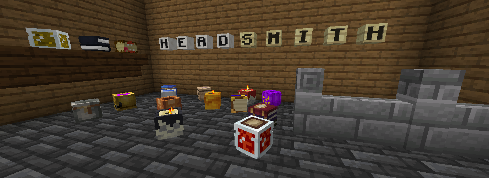
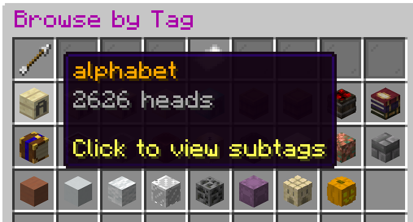
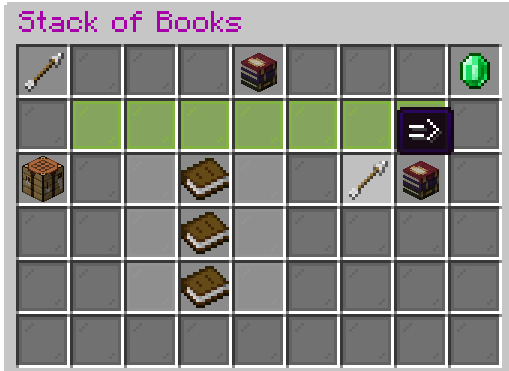
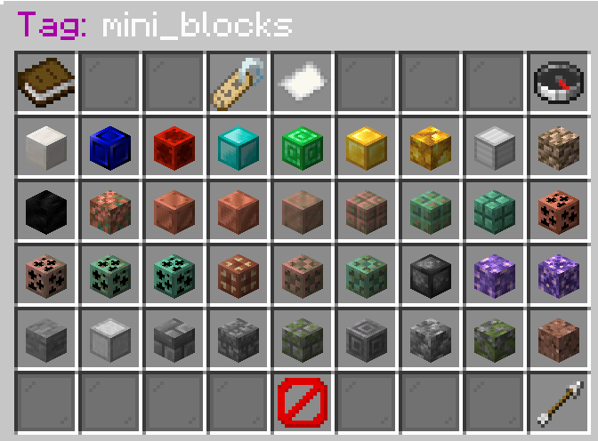
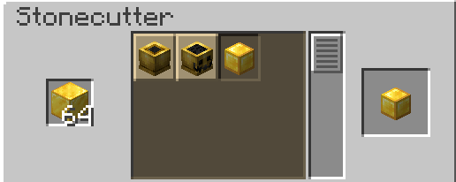
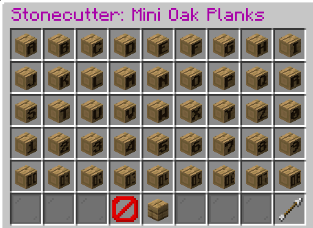

# ⚠️ **MOVED — HeadSmith now lives in [defCoreLib](https://github.com/def9a2a4/defCoreLib)**

[](https://modrinth.com/plugin/headsmith) [](https://def9a2a4.github.io/discord.html)

HeadSmith is now a DefCoreLib companion module. Get the current version and docs here:

- **Readme:** https://github.com/def9a2a4/defCoreLib/blob/main/docs/readmes/headsmith.md
- **Head catalog:** https://def9a2a4.github.io/HeadSmith/ (still hosted from this repo)
- **Download on Modrinth:** https://modrinth.com/plugin/headsmith

Upgrading from this standalone plugin: install DefCoreLib plus the new HeadSmith jar. Heads placed by
the old plugin are adopted automatically on startup (or run `/headsmith migrate`).

*The plugin code here is kept for historical reference only.*

---

# HeadSmith

A Minecraft Paper plugin adding 3300+ survival-friendly decorative and functional heads with crafting recipes.

- Download on Modrinth: [modrinth.com/plugin/headsmith](https://modrinth.com/plugin/headsmith)
- Head Catalog: [def9a2a4.github.io/HeadSmith](https://def9a2a4.github.io/HeadSmith/)




## Features

- **Head Catalog** - Browse hundreds of custom textured heads through an in-game menu: `/headsmith show`
- **Search** - Find heads by name or tags `/headsmith search <query>` or [def9a2a4.github.io/HeadSmith](https://def9a2a4.github.io/HeadSmith/)
- **Crafting** - Depending on the head, craft using shaped/shapeless recipes or stonecutter recipes.
- **Drops** - Control what drops when heads are broken (silk touch support). For example, a [bottle of redstone]() when broken will just drop redstone dust unless broken with silk touch.
- **Special Properties**:
  - Lightable [candles](https://def9a2a4.github.io/HeadSmith/?q=candle) with particle effects
  - [Glowing pumpkins, glowstone, and other blocks](https://def9a2a4.github.io/HeadSmith/?prop=glowing)
  - Functional blocks that open [crafting tables](https://def9a2a4.github.io/HeadSmith/?prop=workbench), [anvils](https://def9a2a4.github.io/HeadSmith/?prop=anvil), enchanting tables, looms, and more

| Description                                                                                            | Preview                                          |
| ------------------------------------------------------------------------------------------------------ | ------------------------------------------------ |
| Browse the catalogue of heads via `/headsmith show`                                                    |                    |
| Head catalog showing how to craft a stack of books                                                     |       |
| Mini block heads collection                                                                            |                  |
| Most blocks can be crafted into mini blocks (and sometimes other decorative items) via the stonecutter |             |
| Put a mini block in a stonecutter to craft mini blocks with symbols                                    |  |


## Commands

Use `/headsmith` or `/hs` to access all commands.

| Command                                       | Description                               | Permission          |
| --------------------------------------------- | ----------------------------------------- | ------------------- |
| `/headsmith`                                  | Show help message                         | -                   |
| `/headsmith help`                             | Show help message                         | -                   |
| `/headsmith show`                             | Open the head catalog menu                | `headsmith.catalog` |
| `/headsmith search <query>`                   | Search for heads by name or tag           | `headsmith.catalog` |
| `/headsmith reload`                           | Reload configuration and head definitions | `headsmith.admin`   |
| `/headsmith give <head_id> [player] [amount]` | Give a head to a player                   | `headsmith.admin`   |

## Configuration

Heads are defined in YAML files and loaded via `config.yml`. Each head can have:

- Custom texture (base64 encoded skin data)
- Display name and lore
- Tags for organization and searching
- Special properties (lightable, glowing, workbench, etc.)
- Crafting recipes (shaped/shapeless)
- Stonecutter recipes
- Drop rules with silk touch conditions

See the `headsmith/src/main/resources/heads/` directory for examples.

### Custom Heads

You can add custom heads by creating YAML files in the plugin's data folder and referencing them in `config.yml`:

```yaml
custom-head-files:
  - my-heads.yml
```

### Overriding Bundled Heads

To override a bundled head with your own version, use the same head ID and add `override: true`:

```yaml
heads:
  mini_diamond_block:
    override: true
    texture: "eyJ0ZXh0..."
    name: "&bCustom Mini Diamond"
    drops:
      on_break:
        - when: { silk_touch: false }
          drops:
            - { material: "DIAMOND" }
```

Without `override: true`, duplicate head IDs will cause an error.